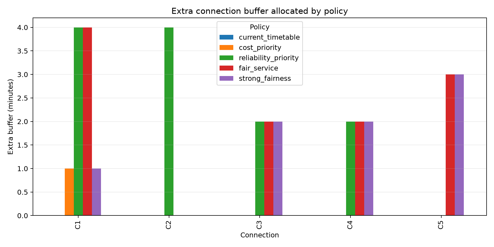
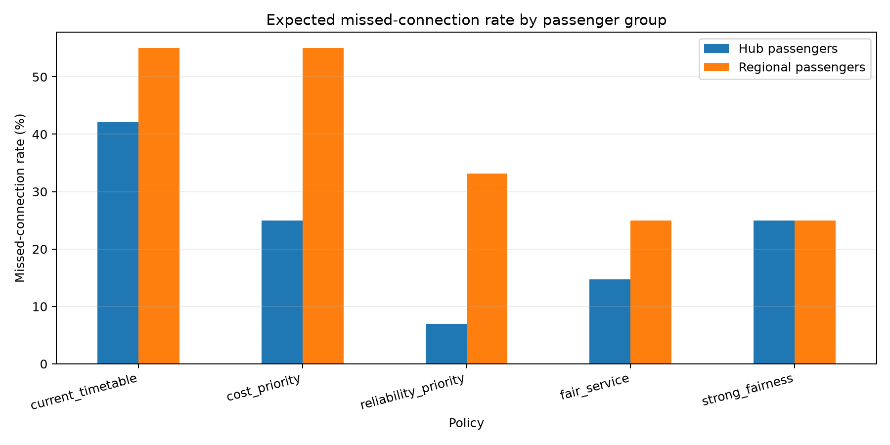

# Transfer Reliable Railway Timetabling

A small, reproducible mixed-integer linear programming project that allocates
connection buffers under uncertain feeder delays. The model balances three
objectives:

1. limiting the operational cost of additional timetable buffer;
2. reducing expected missed connections;
3. limiting the reliability gap between hub and regional passengers.

The project is inspired by the practical trade-off between fast but fragile
rail connections and slower, more robust itineraries. It is designed as an
educational operations-research portfolio project rather than a model of an
actual railway. All data are synthetic.

## Research question

How should a railway operator allocate a limited number of timetable-buffer
minutes when passenger volumes, delay exposure, and minimum service fairness
compete?

## Model overview

For each connection, the model chooses an integer number of additional buffer
minutes. For every delay scenario, a binary variable records whether the
connection can still be made. The objective combines buffer cost, expected
missed passengers, and the absolute difference between hub and regional
missed-connection rates.

The complete mathematical formulation is in [MODEL.md](MODEL.md).

## Repository structure

```text
data/                 Synthetic connections and delay scenarios
src/                  Pyomo MILP model and result extraction
scripts/              Reproducible experiment runner
tests/                Feasibility and policy-behaviour tests
results/              Generated tables and figures
MODEL.md              Mathematical formulation
LEARNING_GUIDE.md     Step-by-step study questions
```

## Installation

Python 3.11 or later is recommended.

```bash
python -m venv .venv
source .venv/bin/activate
python -m pip install --upgrade pip
python -m pip install -r requirements.txt
```

On Windows, activate the environment with:

```powershell
.venv\Scripts\activate
```

## Run the experiments

```bash
python scripts/run_experiments.py
```

The script compares five policies:

- `current_timetable`: no additional buffer;
- `cost_priority`: buffer is available but expensive;
- `reliability_priority`: missed passengers receive greater weight;
- `fair_service`: reliability is optimized together with the group fairness gap;
- `strong_fairness`: the fairness weight is doubled to examine the effect of a stronger equality preference.

Generated results are written to:

- `results/policy_summary.csv`;
- `results/connection_results.csv`;
- `results/figures/buffer_allocation.png`;
- `results/figures/missed_rate_by_group.png`.

## Main results

| Policy | Extra buffer (min) | Expected missed passengers | Hub missed rate | Regional missed rate | Group gap |
| --- | ---: | ---: | ---: | ---: | ---: |
| Current timetable | 0 | 149.0 | 42.1% | 55.0% | 12.9 pp |
| Cost priority | 1 | 113.0 | 25.0% | 55.0% | 30.0 pp |
| Reliability priority | 12 | 51.2 | 7.0% | 33.2% | 26.2 pp |
| Fair service | 11 | 58.4 | 14.7% | 25.0% | 10.3 pp |
| Strong fairness | 8 | 80.0 | 25.0% | 25.0% | 0.0 pp |

The reliability policy minimizes the passenger-weighted failure term and
therefore directs more protection toward high-volume hub connections. Adding
the fairness term changes the allocation: three minutes are moved to the
Dundee regional connection, reducing the hub-regional reliability gap from
26.2 to 10.3 percentage points. The trade-off is 7.2 additional expected
missed passengers relative to the reliability-only solution.

Doubling the fairness weight to 300 eliminates the group gap, but it does so partly by reducing protection for the hub group. The model removes three buffer minutes from C1, total extra buffer falls to eight minutes, and expected missed passengers rise to 80.0. This illustrates a levelling-down limitation of the absolute-gap objective: equal group rates do not necessarily imply a better overall service outcome.





## Run the tests

```bash
pytest -q
```

The tests check buffer feasibility and verify that adding a fairness penalty
does not increase the optimized hub-regional reliability gap.

## Interpretation

The project separates three ideas that are often conflated:

- **Efficiency:** minimize expected missed passengers.
- **Operating cost:** avoid adding unnecessary timetable slack.
- **Fairness:** avoid concentrating poor reliability on passengers using
  lower-volume regional connections.

This makes the example useful for studying how objective-function design can
change an operational decision even when the physical constraints remain the
same.

The numerical results are illustrative rather than policy recommendations:
passenger counts, delays, and scenario probabilities are synthetic. The value
of the exercise is the transparent link from assumptions to formulation,
solution, and policy interpretation.

## Limitations and extensions

The current version uses a small synthetic scenario set and represents
connections independently except for the shared buffer budget. Natural
extensions include:

- headway and platform-capacity constraints;
- vehicle circulation and maintenance windows;
- delay scenarios estimated from real open railway data;
- comparison with a decision-diagram or branch-and-bound formulation;
- multi-objective Pareto analysis instead of fixed objective weights.

## Software

- [Pyomo](https://www.pyomo.org/) for algebraic optimization modelling;
- [HiGHS](https://highs.dev/) as the open-source MILP solver;
- pandas and Matplotlib for data and result analysis.